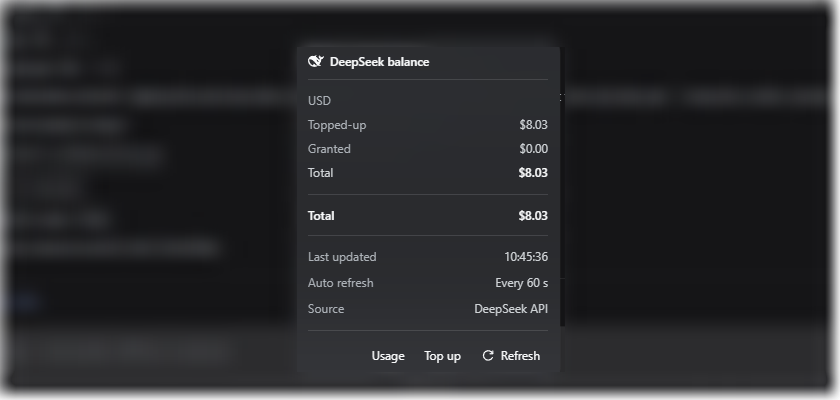

# dsh-deepseek-balance

[](https://www.npmjs.com/package/@jamolpe88/dsh-deepseek-balance)
[](https://github.com/JaMoLpE88/dsh-deepseek-balance/releases)
[](LICENSE)
[](#compatibility)
[](#compatibility)
[](https://dsh-plugin.org/plugins/jamolpe88/dsh-deepseek-balance)

**DeepSeek Platform balance in the DeepSeek Harness composer.** Every currency the account holds lives in one compact pill in the composer tool row, inside the shared centered pill group; click it for a DSH-style details dialog with the topped-up, granted and total balance per currency, the combined total and the official Usage and Top up links.

Zero configuration. The plugin reads the `DEEPSEEK_API_KEY` credential DSH already stores — or the signed-in DeepSeek account when no key exists. No cookie, no scraping, no settings page.

**Español** → [README.es.md](README.es.md)

**Project page** → [jmolo.es/proyectos/dsh-deepseek-balance](https://jmolo.es/proyectos/dsh-deepseek-balance/)



*The details window: one block per currency with its topped-up, granted and total balance, the combined total, last update, auto-refresh cadence, data source and the official Usage and Top up links. The chat background is blurred for privacy.*


*The compact pill: the DeepSeek mark and the balance of every currency with a balance, separated by `·`. It joins the shared centered pill group used by the other JaMoLpE88 plugins and is visible only with a DeepSeek model; with several pills visible they sit side by side, centered, with a small gap.*

## What it does

- Shows the balance of every currency the account holds in one compact pill: `[logo] $8.23 🎁 ¥120.00`.
- Marks the granted part with a gift icon; the topped-up part stays plain. A currency with no balance is not shown at all.
- Opens a native-looking details dialog on click: **topped-up**, **granted** and **total** per currency — zeros included, because the dialog is where the detail belongs.
- Adds the combined total in the same dialog: `$8.23 + ¥120.00`, because currencies never add up. With nothing left it reads **No balance** in red, and it turns red too when the API reports that the balance no longer covers calls.
- Links straight to the official Platform pages: **Usage** and **Top up**.
- Refreshes the balance every 60 seconds and when the app window becomes visible again.
- Appears only while the active model belongs to a DeepSeek provider (`deepseek-official` or `deepseek-account`). Other providers show nothing.
- Appears on a new, empty Session before its first prompt, following the provider the composer's model control displays.
- Joins the centered pill group shared with the other JaMoLpE88 composer plugins: with several pills visible they sit side by side, centered, with a small gap, and hide together when the row is too narrow.

## What it does not do

- It does not read Platform cookies or scrape the usage page.
- It does not ask for a key or store one in the plugin.
- It does not show an expiry countdown: no reachable DeepSeek endpoint exposes the granted balance's expiry date.
- It does not keep balance history, charts, telemetry or local storage.
- It does not add tools, commands or changes to the agent.
- It does not show anything when the active model is not from DeepSeek.

## Why there are no settings

If a DeepSeek model is selected, the provider is configured and its credential is already available to DSH. The plugin resolves that credential on the Host side and reads the official balance API. Without a key it uses the DeepSeek account signed in to the harness. If no DeepSeek model is selected, the plugin has nothing useful to show and renders nothing.

There is no plugin config file, no key input, no threshold editor and no refresh preference. It is what it is: the balance the account already knows about.

## Requirements

- **DSH Desktop** `>= 0.2.1-rc.3`, profile `desktop` (tested on `0.2.1-rc.3`, Windows 11).
- A **DeepSeek** provider configured in **Settings → Models** (`DEEPSEEK_API_KEY`), or a DeepSeek account signed in to the harness.
- Node 22+ (DSH ships its own runtime).

If neither exists you cannot select a DeepSeek model, so the plugin never appears. That is intentional.

## Install

From npm:

```bash
dsh plugin --profile desktop add @jamolpe88/dsh-deepseek-balance
```

From the repository:

```bash
dsh plugin --profile desktop add github:JaMoLpE88/dsh-deepseek-balance
```

From a local checkout, while developing:

```bash
dsh plugin --profile desktop add C:\path\to\dsh-deepseek-balance
```

Refresh the DSH window after installing. The pill appears in the composer of any session whose active model uses a DeepSeek provider.

## Usage

1. Select a model from the **DeepSeek** provider.
2. The pill appears in the composer row, inside the shared centered pill group; other JaMoLpE88 pills sit beside it with a small gap.
3. Click it to open the details dialog.
4. Use **Refresh** for an immediate read; otherwise the plugin refreshes every 60 seconds and when the window becomes visible again.

Click outside the dialog, press **Escape**, or click the pill again to close it.

## How it works

The Host half calls the official balance endpoint with the provider key:

```http
GET https://api.deepseek.com/user/balance
Authorization: Bearer <DEEPSEEK_API_KEY>
```

It answers per currency:

```json
{
  "is_available": true,
  "balance_infos": [
    { "currency": "USD", "total_balance": "8.23", "granted_balance": "0.00", "topped_up_balance": "8.23" }
  ]
}
```

Without a key, the Host half reads the signed-in account instead (`deepseekAccount.getBalance`), which returns the topped-up and granted wallets per currency; the plugin normalizes both sources to the same shape, so the interface never changes.

- The key is resolved from DSH's credential service (`DEEPSEEK_API_KEY`) on each read; `DEEPSEEK_API_KEY` in the process environment is the fallback.
- Results are cached for 55 seconds so the 60-second poll and multiple windows share one upstream request.
- Upstream failures keep the last known balances and mark them **stale** instead of blanking the pill.
- The browser half reads two same-origin routes: `/api/deepseek-balance` and `/api/deepseek-balance/refresh`. The key never reaches the browser.
- Visibility follows the provider the composer's model control displays — the pending selection, the used one, or the catalog default a new Session would send with — so the pill is already there on an empty New Session.
- Amounts use the currency's own symbol and the same format as the DeepSeek Platform site: two decimals rounded down, a **dot decimal separator and a comma for thousands** (`$1,234.56`), independent of the browser language.

## Diagnostics

With DSH running, on the same URL as the interface (the port changes on each start):

```bash
curl http://127.0.0.1:59863/api/deepseek-balance
```

It returns the balances, their source, an error code and a freshness flag — never the key:

```json
{
  "updatedAt": 1793091987909,
  "source": "api-key",
  "currencies": [
    { "currency": "USD", "toppedUp": "8.22", "granted": "0.00", "total": "8.22" }
  ],
  "available": true,
  "error": null,
  "stale": false
}
```

Use `/api/deepseek-balance/refresh` to skip the 55-second cache and force a read. When `error` is not `null`, `stale` tells you whether the balances are the last good values or there are none at all.

## Compatibility

| | |
|---|---|
| DSH | `>= 0.2.1-rc.3` (the only version tested by the author) |
| Node | `>= 22` |
| OS | Windows 11 (tested); macOS and Linux untested |
| Profile | `desktop` |
| Provider | DeepSeek configured in **Settings → Models**, or a DeepSeek account signed in |
| Pill group | Shared with the other JaMoLpE88 composer pills (centered, side by side) |
| Catalog | [listed on dsh-plugin.org](https://dsh-plugin.org/plugins/jamolpe88/dsh-deepseek-balance) |
| Project page | [jmolo.es/proyectos/dsh-deepseek-balance](https://jmolo.es/proyectos/dsh-deepseek-balance/) |

Validation status: **tested on Windows 11 with DSH Desktop 0.2.1-rc.3** (2026-10-27). The pill appears only with a DeepSeek model, the details dialog opens, the per-currency breakdown and the combined total follow the live API, the provider gate hides the pill for other models, and manual refresh works.

Not validated: macOS, Linux, other DSH versions, and the web profile.

## Limits

- **Windows 11 is the only tested platform.** macOS and Linux are not validated.
- **Shares the centered pill group.** When the composer cannot fit every visible pill, the group hides together instead of overlapping the model selector.
- **Only with DeepSeek.** Without that provider there is no useful data, so the plugin renders nothing.
- **No expiry.** DeepSeek reports the granted balance without a date; the countdown was dropped rather than invented.
- **Two currencies today.** DeepSeek documents and returns `CNY` and `USD`; the plugin renders any code it receives, with the code itself as the symbol when the browser does not know it.
- **No history or charts.** Only the current balances.
- **Depends on the DeepSeek endpoint.** If its shape changes, unrecognized entries are dropped and the pill reports a `parse` error.
- **No agent changes.** No tools, commands or model providers are added.

## Privacy

- No cookies, no browser session scraping.
- The API key never leaves the Host process: the browser receives only amounts and currency codes.
- No configuration file, no local storage, no telemetry, no third-party requests beyond the official balance endpoint and the Platform links you click.
- The Host does not log the key or include it in error messages.

## Troubleshooting

**The pill does not appear.**
Check that the active model belongs to a **DeepSeek** provider. The plugin intentionally renders nothing for other providers.

**The pill shows a red dot and an error.**
Open the dialog for the code and hint:

| Code | Meaning |
|---|---|
| `missing-key` | DSH has no `DEEPSEEK_API_KEY` and no DeepSeek account is signed in. Configure the provider in **Settings → Models**. |
| `signed-out` | The account login expired; sign in again or add an API key. |
| `invalid-key` | The provider key was rejected (401). Re-check or replace it in **Settings → Models**. |
| `forbidden` | The key cannot read the balance (403). |
| `account` | The signed-in account could not be read. |
| `rate-limited` | The balance API itself is rate limiting; try again shortly. |
| `timeout` / `network` | The Host could not reach `api.deepseek.com`; retry with **Refresh**. |
| `parse` | The response did not contain recognizable balances. |

The plugin has no settings of its own: provider problems are fixed in DSH's model settings.

## Development

```bash
npm test        # node --test
npm run check   # syntax check for the Host and Client files
```

The tests cover the API parser, the account-wallet parser, amount addition, HTTP error mapping, the cache, the missing-key path, the signed-out path and the stale-data fallback. The Client half is a plain `client.js` bundle (no build step) and is verified in the running Harness.

Local install:

```bash
dsh plugin --profile desktop add C:\path\to\dsh-deepseek-balance
```

## Third-party marks

DeepSeek and the DeepSeek logo are trademarks of DeepSeek. The logo is used only to identify the DeepSeek Platform service; it is not covered by the MIT license that applies to the source code. See [NOTICE](NOTICE).

## License

[MIT](LICENSE) © 2026 JaMoLpE88
